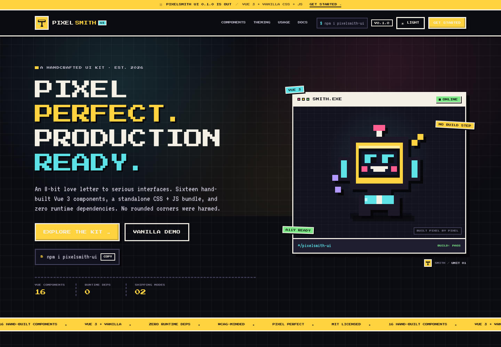
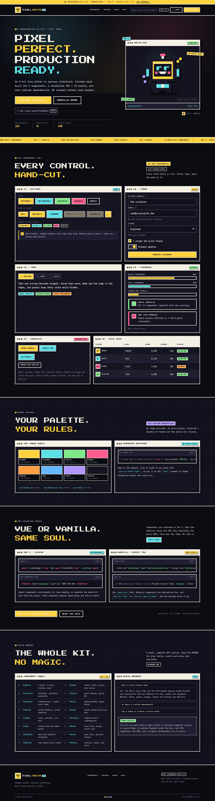

# PixelSmith UI

**Chunky pixels. Serious interfaces.**

PixelSmith UI is a from-scratch, pixel-art UI kit for **Vue 3** and **plain HTML/CSS/JS**.
It ships 16 accessible Vue components, a standalone stylesheet, and a tiny vanilla
behavior runtime. No component framework is borrowed underneath it, no theme was
copied, and the whole visual language was drawn from scratch.

## Why it exists

Most "retro" UI kits stop at a blocky button and a Google Font. PixelSmith UI is
meant to be used: forms, tabs, dialogs, menus, toasts, tables, progress, focus
management, keyboard support, and light/dark themes all ship in the box.

- **16 Vue 3 components** with typed props, slots, and native events.
- **Standalone CSS + JS bundle.** One stylesheet, one script tag, no build step.
- **Zero runtime dependencies.** Vue is an optional peer dependency only.
- **Two themes, one token system.** Every visual choice is a CSS custom property.
- **Accessibility is part of the component.** Focus traps, roving tabindex, ARIA
  wiring, reduced-motion support, and visible 3px focus rings.
- **Self-contained fonts.** The two open-source pixel fonts are embedded in the
  built CSS, so the kit makes no font requests.
- **Built from an empty folder.** The source is plain CSS, TypeScript, and Vue
  SFCs. There is no hidden copy of another design system.

## Install

~~~bash
npm install pixelsmith-ui
# or
pnpm add pixelsmith-ui
~~~

Vue is a peer dependency. It is optional if you only use the vanilla bundle.

## Vue 3

Register the whole kit once:

~~~ts
// main.ts
import { createApp } from 'vue'
import PixelSmith from 'pixelsmith-ui/vue'
import 'pixelsmith-ui/style.css'
import App from './App.vue'

createApp(App).use(PixelSmith).mount('#app')
~~~

Or import only the components you need:

~~~vue

<template>
  <PxInput v-model="email" label="Email" type="email" />
  <PxButton tone="secondary" @click="toast('Saved!')">SAVE</PxButton>
</template>
~~~

The full component index and prop tables live in
[docs/components.md](docs/components.md).

### Vue via script tag

The Vue UMD build is available for quick prototypes and no-build pages:

~~~html
<link rel="stylesheet" href="pixelsmith.css" />

~~~

## Standalone / no build step

~~~html
<link rel="stylesheet" href="pixelsmith.css" />

<button class="pix-btn pix-btn--primary" data-pix-open="hello-modal">
  SAY HELLO
</button>

~~~

The IIFE bundle auto-mounts declarative components and exposes the manager as
<code>window.PixelUI</code>. There is also a complete, tested example at
[examples/standalone.html](examples/standalone.html).

### Declarative behavior

| Attribute | What it does |
| --- | --- |
| <code>data-pix="tabs"</code> | Wires a tablist. Tabs use <code>data-pix-tab="value"</code>; panels use <code>data-pix-panel="value"</code>. |
| <code>data-pix="dropdown"</code> | Wires a menu. Mark the trigger with <code>data-pix-dropdown-trigger</code> and the menu with <code>data-pix-dropdown-menu</code>. |
| <code>data-pix="modal"</code> | Initializes a modal overlay. The dialog is focused, trapped, and restored automatically. |
| <code>data-pix-open="my-modal"</code> | Opens a modal by id, from any element. |
| <code>data-pix-close</code> | Closes the nearest modal. Used by close buttons and backdrops. |
| <code>data-pix-tooltip="Text"</code> | CSS-only tooltip, top by default. Add <code>data-pix-tooltip-pos="bottom"</code> for below. |

### Imperative API

~~~ts
import { createPixelUI } from 'pixelsmith-ui'

const ui = createPixelUI()
ui.mount()

ui.toast({ tone: 'success', title: 'Saved', message: 'All good.' })
ui.openModal('deploy-modal')
ui.closeModal('deploy-modal')

// Re-scan after adding new markup dynamically:
ui.mount(document.querySelector('#dynamic-area')!)

// Remove every listener, overlay, and toast:
ui.destroy()
~~~

The standalone bundle exposes the same methods directly:

~~~js
PixelUI.openModal('deploy-modal')
PixelUI.toast('Saved!')
~~~

## Components

| Category | Vue components | Also available as |
| --- | --- | --- |
| Actions | <code>PxButton</code> | <code>.pix-btn</code> |
| Layout | <code>PxPanel</code>, <code>PxBadge</code> | <code>.pix-panel</code>, <code>.pix-badge</code> |
| Forms | <code>PxInput</code>, <code>PxTextarea</code>, <code>PxSelect</code>, <code>PxCheckbox</code>, <code>PxRadio</code>, <code>PxSwitch</code> | <code>.pix-input</code>, <code>.pix-textarea</code>, <code>.pix-select</code>, <code>.pix-check</code>, <code>.pix-radio</code>, <code>.pix-switch</code> |
| Navigation | <code>PxTabs</code>, <code>PxDropdown</code> | <code>data-pix="tabs"</code>, <code>data-pix="dropdown"</code> |
| Feedback | <code>PxProgress</code>, <code>PxAlert</code>, <code>PxSpinner</code>, <code>PxModal</code>, toast API | <code>.pix-progress</code>, <code>.pix-alert</code>, <code>.pix-spinner</code>, <code>.pix-modal</code> |
| Data & identity | <code>PxAvatar</code> | <code>.pix-table</code>, <code>.pix-avatar</code>, <code>.pix-tag</code> |

  

## Theming

Dark is the default. Put <code>data-pix-theme="light"</code> on the
<code>&lt;html&gt;</code> element (or any subtree) to switch. Every token can be
overridden without a build step:

~~~css
:root {
  --pix-primary: #ff7a18;
  --pix-secondary: #48f2c8;
  --pix-border: 4px;
  --pix-shadow-size: 7px;
  --pix-font-display: 'Press Start 2P', monospace;
  --pix-font-body: 'VT323', monospace;
}
~~~

Core tokens include <code>--pix-bg</code>, <code>--pix-surface</code>,
<code>--pix-ink</code>, <code>--pix-line</code>, <code>--pix-primary</code>,
<code>--pix-secondary</code>, <code>--pix-success</code>,
<code>--pix-danger</code>, <code>--pix-warning</code>, <code>--pix-info</code>,
<code>--pix-accent</code>, <code>--pix-border</code>,
<code>--pix-shadow-size</code>, and <code>--pix-focus</code>. See
[src/styles/tokens.css](src/styles/tokens.css) for the complete list.

## Accessibility

PixelSmith UI is deliberately boring where it matters:

- Buttons, inputs, selects, checkboxes, radios, and switches are native controls.
- Tabs implement the ARIA tabs pattern with roving tabindex and arrow/Home/End keys.
- The modal traps Tab, closes on Escape, locks page scroll, and restores focus.
- Dropdowns support Arrow keys, Home/End, Escape, and outside-click dismissal.
- Toasts use polite/assertive live regions and escape all user text via textContent.
- Every interactive control has a visible 3px focus ring.
- Motion respects <code>prefers-reduced-motion</code>.
- Icons that are decorative are marked <code>aria-hidden</code>; icon-only buttons
  require an accessible label.

## Package exports

| Import | File |
| --- | --- |
| <code>pixelsmith-ui</code> | Vanilla manager, types, metadata |
| <code>pixelsmith-ui/vue</code> | Vue components, plugin, toast composable |
| <code>pixelsmith-ui/style.css</code> | The compiled stylesheet |
| <code>pixelsmith-ui/standalone</code> | The auto-mounting IIFE bundle |
| <code>unpkg.com/pixelsmith-ui</code> | IIFE bundle via the <code>unpkg</code> field |

## Development

~~~bash
pnpm install
pnpm dev          # demo at http://127.0.0.1:5174
pnpm test         # Vitest + jsdom
pnpm typecheck    # vue-tsc
pnpm build        # ESM + standalone + Vue UMD + declarations
pnpm build:demo   # static demo in demo-dist/
pnpm preview      # serve demo-dist/ at :4173
pnpm qa           # Playwright checks: overflow, focus, interactions, UMD
pnpm screenshot   # Playwright screenshots into docs/screenshots/
~~~

The browser checks and screenshot command expect the demo to be served at
<code>http://127.0.0.1:4173</code>. Run <code>pnpm preview</code> in another
terminal first. The built demo is intentionally multi-artifact:
<code>demo-dist/</code> contains the Vue showcase,
<code>demo-dist/examples/standalone.html</code>, and a copy of the distributable
library under <code>demo-dist/dist/</code>.

<code>pnpm qa</code> currently checks 38 behaviors, including:

- No page-level horizontal overflow at 320, 390, 768, 1024, and 1440px.
- The install strip never leaves the viewport.
- Vue and standalone modal focus, Escape, and scroll lock.
- Tabs, dropdowns, toasts, form validation, and theme switching.
- The built Vue UMD bundle renders and receives the stylesheet.

### Output sizes

| Artifact | Raw | Gzip |
| --- | --- | --- |
| <code>pixelsmith.css</code> (fonts embedded) | ~101 KB | ~55 KB |
| <code>pixelsmith.js</code> (vanilla IIFE) | ~13 KB | ~4.4 KB |
| <code>vue.js</code> (Vue ESM) | ~32 KB | ~7.7 KB |
| <code>pixelsmith-vue.js</code> (Vue UMD) | ~31 KB | ~7 KB |

## Project structure

~~~text
pixelsmith-ui/
├─ src/
│  ├─ styles/              tokens, base, component CSS
│  ├─ runtime/             vanilla tabs, modal, dropdown, toast, manager
│  ├─ vue/                 16 Vue SFCs, plugin, useToast
│  ├─ index.ts             vanilla ESM entry
│  └─ standalone.ts        auto-mount IIFE entry
├─ demo/                   Vue showcase application
├─ examples/               standalone.html (plain HTML)
├─ tests/                  Vitest + jsdom
├─ scripts/                demo prep + screenshots
├─ docs/                   API docs and screenshots
└─ index.html              Vite demo entry
~~~

## Browser support

Modern evergreen browsers (Chrome, Edge, Firefox, Safari). The runtime uses
standard DOM APIs and a small amount of <code>:has()</code> for the disabled
checkbox/switch polish. Core behavior does not depend on <code>:has()</code>.
Closed modals use <code>inert</code> plus <code>aria-hidden</code>; CSS
<code>visibility</code> prevents accidental focus in older engines.

## Project provenance

PixelSmith UI was generated with **DeepSeek Harness** from an empty project
directory. The component library, Vue demo, vanilla example, tests, screenshots,
build configuration, and documentation were produced in a DeepSeek Harness agent
session, with product direction and release review from
[azwc](https://github.com/azwc). It is not a fork, reskin, or rebrand of another
UI kit.

The project is maintained as normal source code: every commit is reviewable,
every component has a documented API, and the browser checks live in
[scripts/qa.mjs](scripts/qa.mjs).

## License

Code is MIT licensed. The embedded Press Start 2P and VT323 fonts are licensed
under the SIL Open Font License 1.1; see [FONT-LICENSES.md](FONT-LICENSES.md).

PixelSmith UI was built from scratch for this repository. No existing UI kit,
theme, or component library was copied or rebranded.
